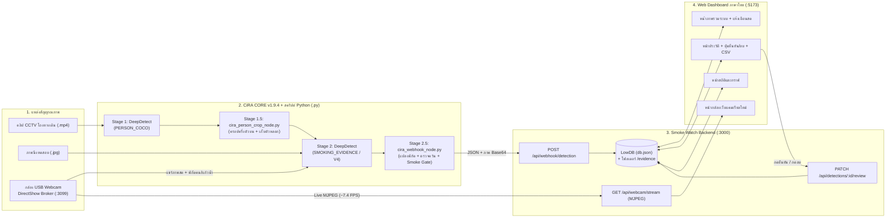
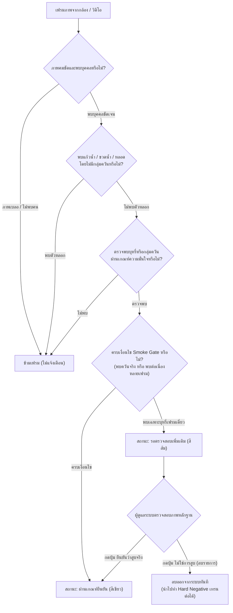
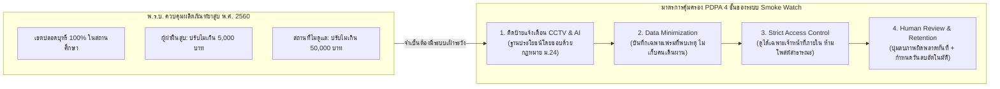

# แผนภาพสถาปัตยกรรมระบบ ลอจิกการตัดสินใจ AI และมาตรการ PDPA (Smoke Watch × CiRA CORE)

## 1. แผนภาพสถาปัตยกรรมระบบรวม (System Architecture Diagram)

---

## 2. แผนภาพเกณฑ์การตัดสินใจ Smoke Gate & Human-in-the-Loop

---

## 3. แผนภาพความเชื่อมโยงกฎหมายควบคุมยาสูบ & การคุ้มครองข้อมูลส่วนบุคคล (PDPA)

